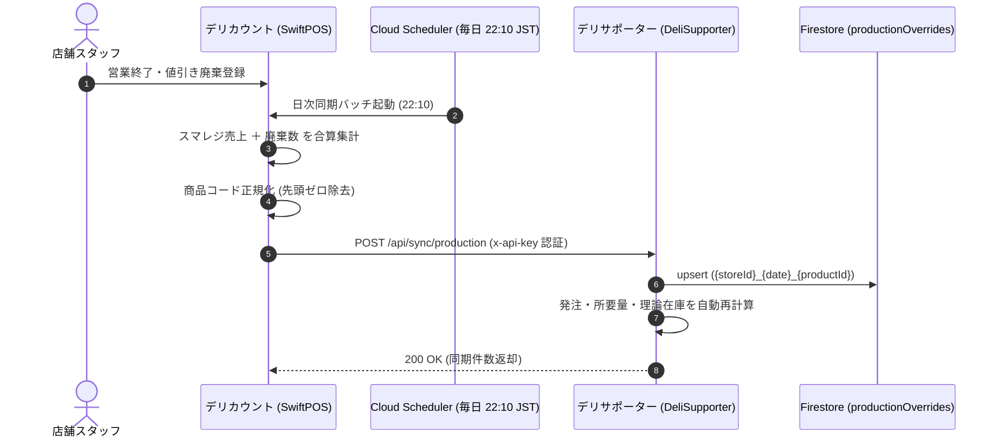

# デリサポーター (DeliSupporter) 連携技術仕様書 (DeliCount側)

本書は、デリカウント（SwiftPOS / 値引き廃棄アプリ）からデリサポーター（DeliSupporter）への製造実績データ連携機能および週3回発注スケジュールの連動仕様をまとめた技術資料です。

---

## 1. 連携概要

デリカウントで毎日計上される「スマレジ売上数」と「値引き・廃棄登録数」から、日別の**製造実績数（売上数 ＋ 廃棄数）**を自動算出し、デリサポーター側の Firestore コレクション（`productionOverrides`）へ同期します。



---

## 2. 送信データ仕様

* **エンドポイント (本番)**: `https://asia-northeast1-[PROJECT_ID].cloudfunctions.net/syncProductionActuals`
* **エンドポイント (開発)**: `http://localhost:3000/api/sync/production`
* **HTTP Method**: `POST`
* **Headers**:
  * `Content-Type: application/json`
  * `x-api-key: delicount-sync-secret-2026`

### ペイロード例
```json
{
  "storeId": "hon-atsugi",
  "targetDate": "2026-10-19",
  "items": [
    {
      "productId": "rec001",
      "productCode": "101",
      "productName": "特製から揚げ弁当",
      "salesQty": 25,
      "wasteQty": 2,
      "productionQty": 27
    }
  ]
}
```

---

## 3. 廃棄クロス分析（`/abc-analysis`）の更新仕様

本厚木店などで発生していた「同一商品名であるにもかかわらず行が分裂して表示される問題」に対応し、以下の正規化集計ロジックを導入しました：

1. **商品名正規化**: 全角半角スペース除去、全角括弧を半角に正規化、小文字化。
2. **マスター統合**: 同一の正規化商品名を持つアイテムは、最新または代表のマスタIDに集約。
3. **キー設定**: 集計マップのキーを `${storeId}|${normStatsName}` とし、完全合算。
4. **値引指標**: 「値引販売個数率（％）」に加えて「値引販売個数（点数）」を画面テーブル、サマリーKPIカード、モーダル、CSV出力のすべてに併記。

---

## 4. 仕入先納品日と発注スケジュール

* **対象仕入先**: スミダパッケージ、オカベ
* **納品可能曜日**: 火曜・木曜・土曜（週3回）
* **デリカウント側の運用サイクル**:
  1. **金曜 22:10 実績確定後**: 翌週 火・水 分を入力 → 火曜納品
  2. **日曜 22:10 実績確定後**: 翌週 木・金 分を入力 → 木曜納品
  3. **火曜 22:10 実績確定後**: 週末 土・日・翌月 分を入力 → 土曜納品
